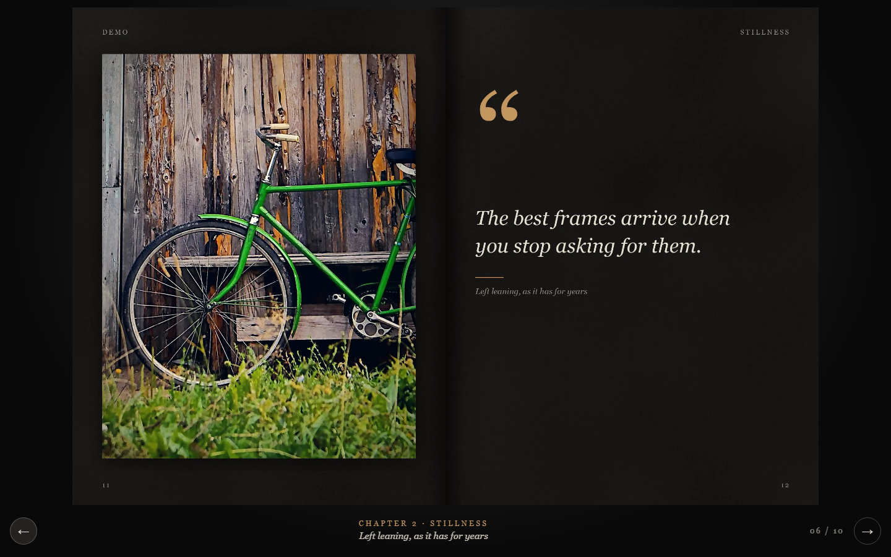

# cinematic-flipbook

把一组照片自动编排成**电影油画质感的双页 3D 翻页画册**。Python 预渲染页面图，StPageFlip 负责翻页；输出是纯静态网站，`file://` 双击就能看，运行时零 API、零 CDN、零上传。

这是一个 [Claude Code](https://claude.com/claude-code) / Agent Skill，也是一套可以独立运行的 Python 工具。



## Demo

- 本地直接打开：[`docs/demo/index.html`](docs/demo/index.html)（不需要服务器）
- 在线 Demo：启用 GitHub Pages 后，把仓库的 Pages 源设为 `/docs`，访问
  `https://<your-username>.github.io/cinematic-flipbook/demo/`
- 全部跨页总览：[`docs/screenshots/spreads.jpg`](docs/screenshots/spreads.jpg)
- 手机端截图：[`docs/screenshots/mobile.png`](docs/screenshots/mobile.png)

Demo 使用 8 张 Unsplash 图片，生成 3 章、10 个跨页、20 页；体积约 1.8MB，QA 在桌面和手机视口都通过。

## 它做什么

```text
照片文件夹
  → 分析（清晰度/曝光/重复/人脸/色彩）
  → 联系表（Contact Sheet）
  → Agent 看图选片、分章、写文案
  → 生成 story-plan.json
  → 排版 + 电影感调色 + 预渲染 1200×1600 WebP
  → StPageFlip 双页翻页站点
  → 自动 QA 截图
```

关键点：**页面是图片，翻页是真实的书页交互**。跨页出血、纸张纹理、撕边、拼贴、中文字体都在 Python 侧完成，避免浏览器端字体和 CSS 的不确定性。

## 特性

- 自动分析、去重、基础选片
- 3–5 章、8–12 个跨页的叙事草稿
- 3 个视觉预设：`cinematic-oil`、`portra-film`、`editorial-mono`
- 5 个版式：`chapter-opener`、`full-bleed`、`diptych`、`asymmetric-pair`、`quote-page`
- 电影感调色：胶片曲线、分离色调、轻油画层、画布纹理、颗粒、暗角
- StPageFlip 翻页：鼠标拖动、按钮、键盘、移动端单页
- 纯静态、离线可看；不请求 CDN，不上传照片
- QA：`file://` + HTTP、桌面 + 手机、图片加载、翻页、横向溢出、控制台错误

## 快速开始

要求：Python 3.10+，Windows / macOS / Linux。

```bash
git clone https://github.com/<your-username>/cinematic-flipbook.git
cd cinematic-flipbook

python -m venv .venv
# Windows
.venv\Scripts\activate
# macOS / Linux
# source .venv/bin/activate

pip install -r requirements.txt
# 仅 QA 需要
playwright install chromium
```

一键构建 demo：

```bash
python scripts/build_album.py \
  --input examples/demo-photos \
  --output out/demo \
  --title "Demo" \
  --style cinematic-oil \
  --seed 1
```

打开 `out/demo/index.html`。

分阶段构建（推荐给 Agent 用）：

```bash
# 1) 分析 + 联系表 + 草稿 story-plan
python scripts/build_album.py \
  --input examples/demo-photos \
  --output out/demo \
  --title "Demo" \
  --style cinematic-oil \
  --seed 1 \
  --stage plan

# 2) 看联系表，改写 out/demo/build/story-plan.json
#    把 reviewed 设为 true

# 3) 排版 + 调色 + 页面
python scripts/build_album.py \
  --input examples/demo-photos \
  --output out/demo \
  --stage render

# 4) 生成网站
python scripts/build_site.py --output out/demo

# 5) QA（需要 playwright + chromium）
python scripts/qa.py --site out/demo
```

产物：

```text
out/demo/
├── index.html
├── album-data.js
├── assets/
├── pages/p01.webp ...
└── build/
    ├── analysis.json
    ├── contact_sheet.jpg
    ├── story-plan.json
    ├── render-report.json
    ├── qa-report.json
    └── qa-desktop.png / qa-mobile.png
```

`build/` 只用于调试和交付前检查，部署时可以删除。

## 作为 Claude Code Skill 使用

把整个仓库放到下面任一位置：

```text
# 个人级（所有项目可用）
~/.claude/skills/cinematic-flipbook/

# 或项目级
<your-project>/.claude/skills/cinematic-flipbook/
```

然后对 Claude Code 说：

> 用 cinematic-flipbook 把 `D:\photos` 做成画册，标题《潮线》，风格 cinematic-oil，8 个跨页，中文文案。

`SKILL.md` 是入口；更细的排版、调色、版式说明在 `SKILL.md` 的“限制 / 已知事项”和脚本注释里。当前版本是刻意压缩的 MVP，参考实现比“完整产品”少一些功能，见下面的 Roadmap。

## 视觉预设

| preset | 气质 | 纸张 | 适合 |
|---|---|---|---|
| `cinematic-oil` | 青橙分离色调、油画笔触、画布肌理 | 深色 | 旅行、夜景、情绪片 |
| `portra-film` | 暖褪色、颗粒、轻 halation | 奶油色 | 人像、家庭、日常 |
| `editorial-mono` | 高对比黑白、细线框、大留白 | 白色 | 纪实、建筑、编辑风 |

预设定义在 `presets/*.yaml`，可以直接改参数，也可以复制一份新增。

## 版式

| 模板 | 说明 |
|---|---|
| `chapter-opener` | 左页章节号/标题，右页整页图 |
| `full-bleed` | 整跨页出血，主体避开中缝 |
| `diptych` | 左右各一张，适合并置 |
| `asymmetric-pair` | 左大右小，制造主次 |
| `quote-page` | 引语 + 一张图，左右交替 |

排版在 2400×1600 的跨页画布上完成，再切成两张 1200×1600 页面。

## 项目结构

```text
.
├── SKILL.md                 # Agent 入口
├── scripts/
│   ├── analyze.py           # 图像分析、dHash、人脸
│   ├── contact_sheet.py     # 联系表
│   ├── build_album.py       # plan / render 主流程
│   ├── pages.py             # 版式渲染
│   ├── grade.py             # 调色 / 油画 / 纹理
│   ├── build_site.py        # 静态站生成
│   └── qa.py                # Playwright QA
├── presets/                 # 3 个视觉预设
├── site/index.html.j2       # 页面模板
├── assets/                  # CSS/JS + vendored StPageFlip
├── examples/                # demo 照片 + story-plan
├── docs/                    # demo 站点 + 截图
└── requirements.txt
```

## 已知限制（v0.1 MVP）

这些是当前版本真实存在的限制，不是“以后再说”的客套话：

- **最多只选 8 张唯一照片**：`build_album.py` 里 `MAX_SELECT = 8`。demo 正好 8 张，所以看起来完整；真实相册需要把这个值和选片逻辑一起改大。
- **没有封面/封底**：`app.js` 使用 `showCover: false`，从章节页直接开始。
- **QA 没有自动化拖动/滑动**：目前只验证按钮、键盘和图片加载；StPageFlip 本身支持拖动，但没有回归测试。
- **UI 是英文**：`index.html` 的 `lang="en"`，底部按钮/章节标签是英文；中文文案本身支持。
- **字体依赖系统**：没有 vendoring 中文字体，换机器可能观感不同。
- **`reviewed: false` 时仍是草稿文案**：脚本不会自动写出好文案，需要 Agent 看图后改写。

## Roadmap

- [ ] 把 `MAX_SELECT` 改成可配置，支持 20–60 张照片
- [ ] 增加封面、封底、硬页打开动画
- [ ] QA 增加拖动 / 手机滑动测试
- [ ] UI 中文化 + `lang` 跟随 album locale
- [ ] 增加 `torn-collage`、`polaroid-cluster` 模板
- [ ] 增加 `dusk-noir`、`sunlit-paper`、`vintage-postcard` 预设
- [ ] 可选 MP4 导出（Playwright 录屏 + ffmpeg）

## Credits

- 翻页：[StPageFlip (page-flip)](https://github.com/Nodlik/StPageFlip) 2.0.7，MIT，vendored 到 `assets/vendor/`，带一行透明清屏补丁。
- Demo 照片：Unsplash License，作者与链接见 [`THIRD_PARTY_NOTICES.md`](THIRD_PARTY_NOTICES.md)。
- 纸张/画布/颗粒/撕边纹理：项目代码程序生成。

## License

代码以 [MIT License](LICENSE) 开源。Demo 照片不属于 MIT 授权范围，见 [`THIRD_PARTY_NOTICES.md`](THIRD_PARTY_NOTICES.md)。

## Contributing

See [`CONTRIBUTING.md`](CONTRIBUTING.md). Issues and PRs are welcome.
